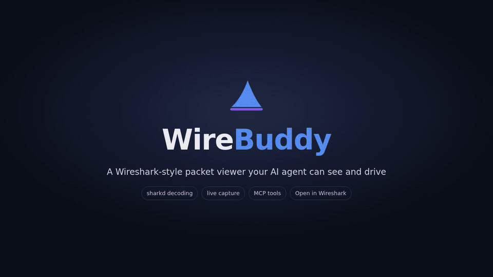
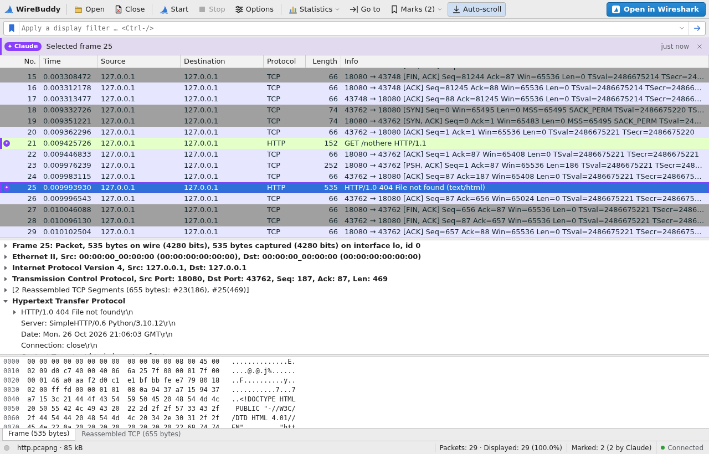

# WireBuddy

[](https://github.com/dngames/wirebuddy/actions/workflows/ci.yml)
[](LICENSE)

<p align="center">
  <a href="docs/demo.mp4"></a>
  <br><sub>50-second demo · <a href="docs/demo.mp4">MP4 version</a></sub>
</p>

A lightweight, Wireshark-style packet viewer that runs in a browser tab — built to sit next to
an AI chat (e.g. the Claude Code desktop app's browser pane) so you and the agent look at the
same capture, filter, selected packet and marks.

- **Packet list / details / bytes** like Wireshark, with its menu bar, main toolbar and keyboard
  shortcuts: coloring rules, display filter bar with live validation and field autocompletion,
  linked tree ↔ hex highlighting, custom columns ("Apply as Column"), Find Packet (display
  filter, string or hex), packet history, zoom.
- **Follow Stream** like Wireshark's window: TCP, UDP, TLS, HTTP and more; the packet list
  shows the stream while it is open; step through streams, show data as ASCII, C Arrays, Hex
  Dump, UTF-8 or Raw, find text, filter the stream out, save it.
- **Select several packets** with Ctrl+click and Shift+click to mark, copy or export them — the
  agent sees the selection too, so you can ask "what's wrong with these packets?".
- **Statistics:** Expert Information, I/O Graph, protocol hierarchy, conversations and
  endpoints, optionally limited to the display filter.
- **TLS decryption** with a key log file (`SSLKEYLOGFILE`), and **Export Specified Packets**
  (displayed, marked, selected or a range) to a new pcapng/pcap.
- **Live capture** with `dumpcap` and Wireshark's Capture Options dialog: interfaces with live
  traffic sparklines (also on the start page), promiscuous mode, a capture filter checked as you
  type, new files automatically, a ring buffer and stop conditions. The view updates about once a
  second.
- **Open in Wireshark** jumps to the real GUI with the same file, filter and packet.
- **MCP server** so an agent can start and stop captures, read the capture, apply filters,
  select and mark packets, and follow streams.
- **Extensions:** when traffic shows up as undecoded "Data", the agent can write a Lua dissector
  for it, test it on the open capture and reload the view, which then decodes the new protocol
  with fields you can filter on.

All protocol decoding is done by Wireshark's own engine (`sharkd`), so dissection is identical
to Wireshark.



## Requirements

- **Wireshark 4.6** with `sharkd`, `editcap` and `mergecap` (Debian/Ubuntu package
  `wireshark-common`); the `wireshark` package too for "Open in Wireshark". Older versions are
  untested, and Ubuntu 22.04 and 24.04 ship 3.6 and 4.2, so take the Wireshark PPA there:

  ```bash
  sudo add-apt-repository ppa:wireshark-dev/stable
  sudo apt install wireshark-common wireshark
  ```

- **For live capture**, `dumpcap` must be allowed to capture as your user:

  ```bash
  sudo dpkg-reconfigure wireshark-common   # answer "Yes"
  sudo usermod -aG wireshark $USER         # then log out and in again
  ```

- **Node.js ≥ 22**

Developed on Ubuntu 22.04 with Wireshark 4.6.6; CI runs on Ubuntu 24.04 with the current stable
Wireshark from the PPA. Other Linux distributions should work; macOS and Windows are untested.

## Build and run

```bash
npm install
npm run build
npm start                      # prints the UI URL, e.g. http://127.0.0.1:8765/?token=…
node dist/server/main.js path/to/capture.pcapng   # open a file right away
```

Options (`--help` shows the same):

| Option | Environment | |
|---|---|---|
| `--port <n>` | `WIREBUDDY_PORT` | HTTP port on 127.0.0.1; default 8765, falls back to a free one |
| `--token <t>` | `WIREBUDDY_TOKEN` | session token, at least 16 characters; default random. Prefer the variable: other local users can see command lines in `ps` |
| `--capture-dir <dir>` | `WIREBUDDY_CAPTURE_DIR` | where live captures go; default `~/.local/share/wirebuddy/captures` |
| `--profile <name>` | `WIREBUDDY_PROFILE` | Wireshark configuration profile for dissection and Open in Wireshark |
| `--tls-keylog <file>` | | decrypt TLS with this key log file |
| | `WIREBUDDY_EXTENSIONS` | more folders of extensions, separated by `:` |
| `--mcp` | | also serve MCP over stdio; logs go to stderr |
| `--watch <file>` | | wait for the next problem in a running viewer, print it, exit (see below) |
| `--version` | | print the version |

## TLS decryption

Start the program whose traffic you want to read with `SSLKEYLOGFILE` set, e.g.

```bash
SSLKEYLOGFILE=~/tls-keys.log firefox
```

then choose that file under **Tools → TLS Keys…** in WireBuddy (or start WireBuddy with
`--tls-keylog ~/tls-keys.log`). The capture is re-dissected, HTTP/2, HTTP and other protocols
inside TLS become visible, and "Open in Wireshark" passes the key log on. A key log file set in
Wireshark's own preferences is picked up automatically. The agent can see whether decryption is
on, but only you choose the file. Treat the key log like a password.

## Extensions

Wireshark decodes thousands of protocols, but not your company's sensor stream or a game's
network protocol: those show up as "Data". Ask the agent to decode them. It finds the undecoded
traffic (`capture_summary` lists it), works out the format from the bytes or from a spec you give
it, and writes a Lua dissector into WireBuddy's extension folder:

```
~/.local/share/wirebuddy/extensions/<name>/
  extension.json    {"label": "ACME telemetry", "version": "1", "description": "…"}
  acme.lua          a Wireshark Lua dissector
```

It tests the extension against the open capture in a separate `sharkd` first, then reloads the
view, which decodes the new protocol: its fields appear in the details tree, in filters and
autocompletion, as columns and in "Open in Wireshark". Problems come back to the agent: Lua that
doesn't load, dissectors failing on some packets (with the frame and line), endless loops (stopped
after a second), an extension that crashes `sharkd` (switched off when it crashes while loading;
the view keeps its previous extensions when one crashes while reading the capture).

**Analyze › Extensions…** lists the extensions with their status and switches them on and off;
**Analyze › Reload Lua Plugins** (Ctrl+Shift+L) loads them again after you edited one. You can
write extensions yourself the same way, or share a folder of them with `WIREBUDDY_EXTENSIONS`.

Extensions are Lua code that runs as you, with access to your files. WireBuddy only loads
extensions no other user could have changed (see [SECURITY.md](SECURITY.md)): a shared team
folder that colleagues can write is ignored, and so is a folder on a network or FUSE filesystem,
where that can't be checked. Only let an agent write extensions if you would let it run commands,
and look at what it wrote. Extensions need Linux.

### Panels

An extension can also bring a **panel**: a small web page of its own (`panel/main.js`, plus
optional HTML, CSS and further modules) that WireBuddy shows in a window next to the packets.
The agent writes one when a picture says more than packet rows, checks it
(`extensions action "test"` finds syntax errors with file and line), opens it with the `panel`
tool and gets told whether it started, what it shows and every error it throws. You open panels
under **View › Panels** or in Analyze › Extensions.

Each panel runs sandboxed on a one-time origin of its own (`p<random>.localhost`), in its own
browser process: it can't reach WireBuddy's API, its token or the network, only its own files. A
panel that stops responding is stopped after 20 seconds without slowing WireBuddy down; one that
tries to navigate is closed.

## Dissector plugins and profiles

WireBuddy decodes with `sharkd`, which loads the same plugins and settings as Wireshark:

- **C plugins** from the global folder (e.g. `/usr/lib/x86_64-linux-gnu/wireshark/plugins/4.6/epan`)
  and the personal one (`~/.local/lib/wireshark/plugins/4.6/epan`).
- **Lua plugins** from the global folder, `~/.local/lib/wireshark/plugins` and
  `~/.config/wireshark/plugins`.
- **Preferences, Decode As, enabled/disabled protocols, coloring rules** from `~/.config/wireshark`.
- **Profiles**: `--profile <name>` starts `sharkd` (and "Open in Wireshark") with that
  configuration profile.

A plugin's fields show up in the details tree, can be filtered on, appear in filter
autocompletion, and are visible to the agent through `inspect_frame`. After changing a Lua
plugin, use Analyze › Reload Lua Plugins; restart WireBuddy after adding a C plugin.

## Use with Claude Code

Register the MCP server (it also starts the web UI):

```bash
claude mcp add wirebuddy -- "$(command -v node)" /path/to/wirebuddy/dist/server/main.js --mcp
```

(`$(command -v node)` stores the full path of your `node`, so it is found even when Claude Code
starts the server with a different `PATH`.)

To see what the agent side looks like without Claude, `node test/agent-demo.mjs` plays a short
scripted session (filter, mark, select) against the fixture; open the URL it prints.

Claude opens the viewer in the browser pane next to the chat by itself as soon as it starts
working with WireBuddy: while no viewer is connected, the tool results remind it, with the URL.

While Claude is attached, the viewer shows you no error messages. Problems (a file that won't
open, a rejected filter, a failed capture, a crashed `sharkd`) and what you do in the viewer go
to Claude instead, with its next WireBuddy tool call; the status bar only counts the problems
waiting for it. To react while you work, Claude runs `wirebuddy --watch <instance-file>` as a
background command: it waits for the next problem, prints it and exits, which wakes Claude.

Example prompts:

- "Open ~/captures/slow-login.pcapng and tell me why the login is slow."
- "Explain the packet I have selected."
- "Mark all DNS failures and filter to them."
- "Capture on eth0 for a minute and tell me when you see TCP retransmissions."

### Example: which site did I just visit?

> Capture my traffic while I open a website, then tell me which site it was.

The agent picks the interface that carries the default route and calls `start_capture` with a
capture filter that keeps only DNS queries, plain HTTP requests and the first packet of every TLS
and QUIC connection, never the encrypted page data:

```
port 53 or (tcp dst port 80)
  or (ip and tcp dst port 443 and tcp[((tcp[12]&0xf0)>>2)] = 0x16 and tcp[((tcp[12]&0xf0)>>2)+5] = 1)
  or (ip6 and ip6[6] = 6 and tcp dst port 443 and ip6[40 + ((ip6[52]&0xf0)>>2)] = 0x16 and ip6[40 + ((ip6[52]&0xf0)>>2) + 5] = 1)
  or (ip and udp dst port 443 and (udp[8] & 0xf0) = 0xc0)
  or (ip6 and ip6[6] = 17 and udp dst port 443 and (ip6[48] & 0xf0) = 0xc0)
```

When you say you are done, it stops the capture and lists the names with `query_packets`, filter
`tls.handshake.type == 1 || dns.flags.response == 0 || http.request` and fields
`frame.time_relative`, `tls.handshake.extensions_server_name`, `dns.qry.name` and `http.host`.
The TLS field covers QUIC too: Wireshark decrypts QUIC's Initial packets and finds the same
ClientHello inside. The agent then names the site, tells it apart from background traffic by
time, and lists the CDN and third parties (consent managers, trackers) the page pulled in.

- The page itself stays encrypted: no content, no video title. To read your own browser's
  traffic, start it with `SSLKEYLOGFILE` and set that file in WireBuddy.
- Encrypted DNS and Encrypted Client Hello can hide the name; other programs on the machine show
  up in the same capture.
- libpcap's `tcp[...]` and `udp[...]` offsets only match IPv4, hence the `ip6[...]` clauses (they
  assume no IPv6 extension headers). Without them every IPv6 connection is dropped silently.

### MCP tools

| Tool | What it does |
|---|---|
| `viewer_url` | URL of the UI to show in the browser pane |
| `get_view_state` | What the user sees: file, counts, filter, selected frame and selected packets, marks, capture status |
| `open_capture` | Open a capture file in the viewer |
| `capture_summary` | Protocol hierarchy, top conversations, expert info counts |
| `query_packets` | Paginated rows for any display filter, or exact field values per packet with `fields` (like `tshark -T fields`) |
| `inspect_frame` | Protocol tree of one frame as compact text, optionally limited to protocols, with hex |
| `follow_stream` | Reassembled stream payload as text |
| `expert_info` | Expert Information grouped by severity and message, with example frames |
| `io_graph` | Packets/bytes/bits over time for up to 4 filters: peaks, empty stretches, a downsampled series |
| `export_packets` | Write matching, displayed, marked, selected or ranged packets to a new capture file |
| `check_display_filter` | Validate a filter; hints when capture-filter (BPF) syntax was used |
| `set_display_filter` | Apply a filter in the user's view |
| `goto_frame` | Select and scroll to a frame |
| `mark_frames` / `clear_marks` | Highlight frames with a note (listed under Go → Marked Packets) |
| `set_columns` | Show fields as extra columns in the user's packet list |
| `list_interfaces` | Capture interfaces with their current traffic (read-only) |
| `start_capture` | Start a live capture with the Capture Options settings; the view follows it |
| `stop_capture` | Stop the running capture |
| `open_in_wireshark` | Open the capture in the real Wireshark at the selected frame |
| `extensions` | Lua dissector extensions and panels: a guide with templates, list, test one on the open capture, reload, enable, disable |
| `panel` | Open, reload, check on or close an extension's panel in the user's view |

Every agent action that changes the view shows a notice in the UI. Every tool result also
carries what happened in the viewer since the agent's last call: problems and what you did.

## How it works

```
 browser (src/web)  ──HTTP/WebSocket──▶  Node server (src/server)  ──stdio JSON-RPC──▶  sharkd ×2
                                              │                                         (alternate during
 Claude (MCP over stdio) ────────────────────▶│                                          live reloads)
                                              └──▶ dumpcap (live capture → .pcapng)
                                              └──▶ wireshark -r … -Y … -g …
```

- One server process holds the view state; the UI and the MCP tools share it.
- During a live capture, one `sharkd` answers requests while the other re-reads the growing
  file; then they swap, so the UI never waits for a reload.
- The packet list is virtualized and pages rows from `sharkd`, so large captures stay smooth.

## Security

- **The session token is the only boundary.** Anyone or anything holding the viewer URL with its
  token can do everything you can in the UI, starting a capture included. That covers an AI agent
  that also has a shell or controls the browser pane: give WireBuddy only to agents you trust,
  and don't share the URL.
- The server listens on `127.0.0.1` only. API calls need the random per-session token in an
  `X-WireBuddy-Token` header (the WebSocket takes it in its URL); it is compared in constant time.
- Requests with a foreign `Host` (DNS rebinding), any `Origin` but the server's own (`null`
  included) or a body that isn't JSON are refused. The page has a Content Security Policy.
- The MCP tools can start and stop captures on the interfaces `dumpcap` may capture on, always
  into WireBuddy's capture folder. They can open any capture file you can read, read packets,
  change the filter, marks, selection and columns, open Wireshark, and write new
  `.pcap`/`.pcapng` exports where you can write; an existing file is never replaced unless the
  agent exported it itself in the same session.
- Open only accepts files whose content is a capture (pcap, pcapng, snoop, Network Monitor; also
  gzip- or zstd-compressed), whatever their name, so it can't be used to read other files.
- Live captures and exports are readable only by you (files `0600`, capture folder `0700`).
- Extensions are Lua code that runs as you inside `sharkd` and the Wireshark WireBuddy opens. The
  MCP tools can test, reload and switch extensions, not write them: an agent writes them with its
  own file tools, so it needs file access anyway. Extensions another user could have changed are
  not loaded.
- The traffic sparklines and `list_interfaces` only read per-interface packet counters
  (`dumpcap -S`), never packet contents; that sampler runs only while something shows it.

## Tests

```bash
npm run build
npm test             # HTTP API and MCP tools against test/fixtures/http.pcapng
npm run test:live    # live capture on loopback: pings 127.0.0.1, runs a local HTTPS server
```

The tests run their servers with an empty home folder, so your own Wireshark preferences and
plugins don't change the results. The capture checks in `npm test` need `dumpcap` permissions
(see Requirements) and are skipped without them; `npm run test:live` needs them.

## Limitations

- A live capture re-reads the whole current file on every update, so very long or busy captures
  get slower to refresh; use a ring buffer or a capture filter for those.
- No packet comments or time references yet.
- In the Wireshark window that "Open in Wireshark" starts, the interface list stays empty until
  Capture → Refresh Interfaces (F5): Wireshark skips the scan when it starts with a file.

## Contributing

Issues and pull requests are welcome — see [CONTRIBUTING.md](CONTRIBUTING.md). Please report
security problems privately as described in [SECURITY.md](SECURITY.md).

## License

[MIT](LICENSE) © 2026 Michael Haar

Wireshark and the "fin" logo are registered trademarks of the Wireshark Foundation. WireBuddy is
an independent project and is not affiliated with or endorsed by the Wireshark Foundation.
